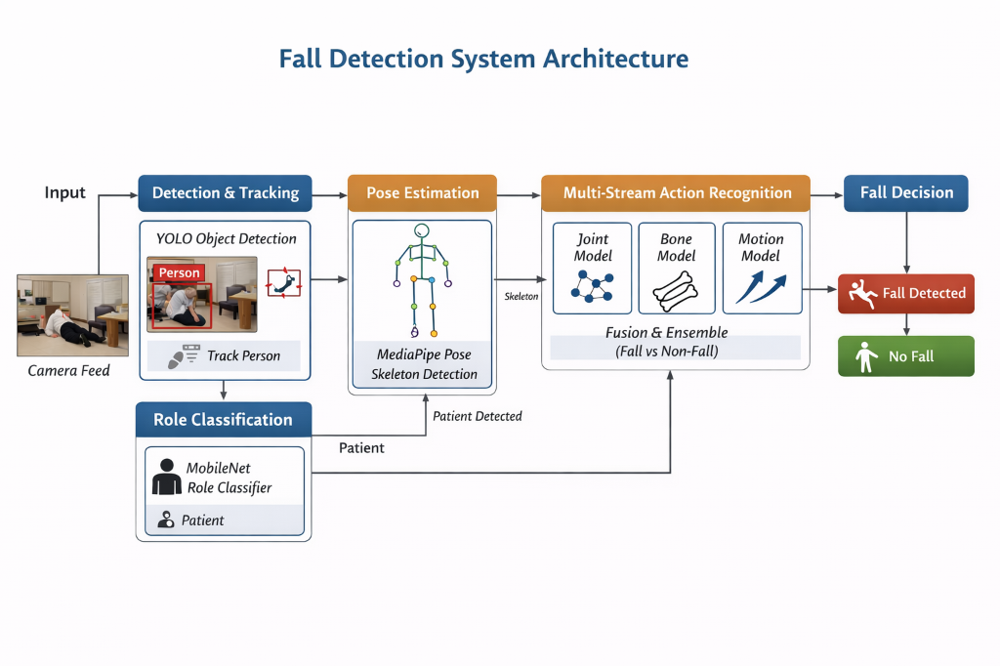

# AI-Powered Fall Detection & Healthcare Monitoring System

> Real-time and video-based patient fall detection using a four-stage deep learning pipeline — YOLOv8 · MobileNetV3 · MediaPipe · CTR-GCN — with a full Streamlit analytics dashboard.

---

## Overview

Unattended patient falls are among the leading causes of injury in clinical settings. Manual monitoring of CCTV feeds is impractical at scale. This system automates that monitoring using computer vision and graph neural networks.

It detects falls from live webcam/RTSP feeds or uploaded video files, classifies the roles of detected individuals (patient, medical staff, visitor), estimates full-body skeletal pose, and delivers a professional web dashboard with analytics, event snapshots, and downloadable reports.



---

## Features

- **Person Detection & Tracking** — YOLOv8 detects all individuals and assigns persistent IDs across frames
- **Role Classification** — MobileNetV3-Large classifies each person as patient, medical staff, or other based on visual appearance
- **Pose Estimation** — MediaPipe extracts 33 body landmarks per person, mapped to a 25-joint NTU skeleton
- **Fall Detection** — CTR-GCN graph neural network analyses 72-frame skeleton sequences for fall/non-fall classification
- **Physical Signal Boosting** — bounding-box aspect ratio and hip velocity signals boost fall probability independently of the neural network
- **Multi-window Inference** — 3 staggered CTR-GCN windows catch fast falls that peak mid-buffer
- **Streamlit Dashboard** — upload video, view processed output, analytics charts, fall event cards with snapshots, CSV exports
- **Live Monitoring** — real-time webcam/RTSP pipeline with configurable alarm confirmation

---

## Demo

| Original | Processed (skeletons + labels) |
|----------|-------------------------------|
| Person detected, bounding box shown | Skeleton overlay, role label, fall probability, FALL banner on alarm |

Run the dashboard:
```bash
streamlit run app.py
```
Then open **http://localhost:8501**, upload a video, and click **Analyse Video**.

---

## Pipeline Architecture

```
Video Input (file / webcam / RTSP)
         │
         ▼
 ┌───────────────────────────────┐
 │  Stage 1 — Person Detection  │  YOLOv8n
 │  Bounding boxes + Track IDs  │
 └───────────────┬───────────────┘
                 │
                 ▼
 ┌───────────────────────────────┐
 │  Stage 2 — Role Classification│  MobileNetV3-Large
 │  patient / medical_staff /    │
 │  other                        │
 └───────────────┬───────────────┘
                 │  (patients prioritised)
                 ▼
 ┌───────────────────────────────┐
 │  Stage 3 — Pose Estimation   │  MediaPipe Pose Landmarker
 │  33 landmarks → 25-joint NTU │
 │  skeleton                     │
 └───────────────┬───────────────┘
                 │
                 ▼
 ┌───────────────────────────────┐
 │  Stage 4 — Fall Detection    │  CTR-GCN
 │  72-frame sliding window      │
 │  fall probability + alarm     │
 └───────────────────────────────┘
                 │
                 ▼
     Streamlit Dashboard / Alert
```

---

## Model Details

### Stage 1 — YOLOv8n Person Detector
| Property | Value |
|----------|-------|
| Architecture | YOLOv8 Nano |
| Base training | COCO dataset |
| Fine-tuning | Hospital scene footage |
| Input resolution | 960 × 960 |
| Confidence threshold | 0.25 (configurable) |
| Tracking | ByteTrack (Ultralytics, `persist=True`) |

### Stage 2 — MobileNetV3-Large Role Classifier
| Property | Value |
|----------|-------|
| Architecture | MobileNetV3-Large |
| Output classes | patient, medical_staff, other |
| Input | 224 × 224 crop, ImageNet normalisation |
| Best validation accuracy | 80.93 % |
| Best validation macro F1 | 77.86 % |
| Best validation weighted F1 | 81.36 % |

### Stage 3 — MediaPipe Pose Landmarker
| Property | Value |
|----------|-------|
| Model | MediaPipe Pose Landmarker Full (9 MB) |
| Landmarks | 33 body keypoints (x, y, z normalised) |
| Output skeleton | 25-joint NTU RGB+D format |
| Temporal smoothing | Exponential moving average α = 0.85 on limb joints |
| Auto-download | Yes — fetched on first run if not present |

### Stage 4 — CTR-GCN Fall Detector
| Property | Value |
|----------|-------|
| Architecture | Channel-wise Temporal Relational GCN, 10 blocks |
| Input tensor | (1, 3, 72, 25, 2) — channels, time, joints, persons |
| Training data | HAR-UP dataset, impact-centred windows |
| Window size | 72 frames at 18 fps ≈ 4 seconds |
| Test samples | 655 |
| **Accuracy** | **91.59 %** |
| **Fall recall** | **98.83 %** |
| **Fall precision** | **91.22 %** |
| **Fall F1** | **94.87 %** |
| **ROC-AUC** | **95.98 %** |

#### Confusion Matrix (threshold 0.50)

| | Predicted non-fall | Predicted fall |
|---|---:|---:|
| **Actual non-fall** | 90 | 49 |
| **Actual fall** | 6 | 509 |

---

## Project Structure

```
patient-fall-detection/
│
├── app.py                              # Streamlit dashboard (4 tabs)
├── requirements.txt
├── system_diagram.png
│
├── runtime/
│   ├── video_processor.py              # Offline video processing engine
│   ├── real_time_fall_detection_pipeline.py   # Live webcam/RTSP pipeline
│   ├── patient_detection_tracking.py   # Standalone YOLO tracking script
│   ├── pose_motion_classification.py   # Standalone pose + CTR-GCN script
│   ├── role_classifier.py              # MobileNetV3 wrapper class
│   ├── mediapipe_functions.py          # 33-to-25 joint conversion
│   ├── ctrgcn_model.py                 # CTR-GCN architecture
│   └── graph/
│       ├── ntu_rgb_d.py                # NTU-25 skeleton graph definition
│       └── tools.py
│
├── model_weights/
│   ├── patient_detection_yolov8n.pt            # 6.3 MB
│   ├── role_classification_mobilenetv3_best.pt # 17 MB
│   ├── role_classification_mobilenetv3_config.yaml
│   ├── fall_motion_ctrgcn_72f_impact.pt        # 5.8 MB
│   └── pose_landmarker_full.task               # 9.0 MB (auto-downloaded)
│
├── training/
│   ├── patient_detection_yolo/
│   ├── role_classification_mobilenetv3/
│   ├── pose_preprocessing_mediapipe/
│   └── fall_motion_ctrgcn/
│
├── evaluation/
│   ├── scripts/
│   └── results/
│
└── runtime_outputs/                    # Processed video output goes here
```

---

## Installation

### Requirements
- Python 3.10 – 3.13
- Windows / Linux / macOS
- GPU optional (CUDA speeds up inference significantly)

### Setup

```bash
# Clone the repository
git clone https://github.com/Sowmya017/patient-fall-detection-.git
cd patient-fall-detection-

# Create and activate virtual environment
python -m venv .venv

# Windows
.venv\Scripts\activate

# Linux / macOS
source .venv/bin/activate

# Install dependencies
pip install -r requirements.txt
```

> **GPU users:** install the CUDA build of PyTorch before the above step.
> Visit https://pytorch.org/get-started/locally/ and select your CUDA version.

---

## Usage

### Option 1 — Streamlit Dashboard (Recommended)

```bash
streamlit run app.py
```

Open **http://localhost:8501** in your browser.

**Dashboard tabs:**

| Tab | What it shows |
|-----|---------------|
| 📹 Video Analysis | Upload video → process → original vs. annotated side-by-side + download |
| 📊 Analytics | Role pie chart, fall probability timeline, people count, per-person table |
| ⚠️ Fall Events | Event cards with snapshots, Gantt timeline, CSV export |
| 📡 Live Monitor | Auto-generated CLI command for webcam/RTSP, snapshot test |

**Sidebar settings:**

| Setting | Default | Description |
|---------|---------|-------------|
| Sensitivity preset | Balanced | Sensitive (0.65) / Balanced (0.75) / Conservative (0.88) |
| Fall threshold | 0.75 | Boosted p(fall) above which prediction counts as fall |
| Warning threshold | 0.45 | p(fall) above which a yellow warning is shown |
| Role confidence | 0.50 | Minimum confidence to trust a role label |
| Infer every N frames | 6 | CTR-GCN inference frequency |
| Max pose targets | 3 | Simultaneous people to run pose + fall detection on |
| Alarm confirmation | 0.6 s | Consecutive fall predictions needed before alarm fires |

---

### Option 2 — Live Webcam / RTSP Pipeline

```bash
# Webcam (index 0)
python runtime/real_time_fall_detection_pipeline.py --source 0

# Video file with output saving
python runtime/real_time_fall_detection_pipeline.py \
    --source path/to/video.mp4 \
    --output runtime_outputs/result.mp4

# RTSP stream
python runtime/real_time_fall_detection_pipeline.py \
    --source rtsp://username:password@ip:port/stream

# Common options
#   --fall-threshold 0.75     fall probability threshold
#   --max-patients 2          max simultaneous pose tracks
#   --disable-role-classifier  run on all detected people
#   --no-display              headless mode (no window)
```

Press **ESC** in the display window to stop.

---

### Option 3 — Standalone Scripts

```bash
# Person detection + tracking only
python runtime/patient_detection_tracking.py --video path/to/video.mp4

# Pose estimation + fall classification only (no YOLO / role)
python runtime/pose_motion_classification.py --video path/to/video.mp4
```

---

## Fall Detection Improvements

The following enhancements were made over the base pipeline to improve detection of fast falls:

| Enhancement | Detail |
|-------------|--------|
| **FPS normalisation** | Input skeleton frames sub-sampled to 18 fps to match training distribution. At 30 fps input, raw buffering would compress 4 s of motion into 2.4 s, causing temporal mismatch. |
| **Multi-window inference** | CTR-GCN runs on 3 staggered windows (shifted by 18 frames). Max p(fall) is taken. Fast falls that peak mid-buffer are captured by at least one window. |
| **Bbox aspect ratio boost** | Standing: tall narrow bbox (aspect > 1.5). Fallen: wide flat bbox (aspect < 0.9). Boosts p(fall) by ×1.50 when lying down, ×1.35 when actively transitioning. |
| **Hip velocity boost** | Rapid downward hip movement (> 7 % of frame height across 6 frames) boosts p(fall) by ×1.30. |
| **Short-video support** | Buffer triggers at ≥ 15 frames instead of requiring full 72. Short sequences are tiled to fill the window. |
| **FPS-adaptive alarm** | Confirmation streak calculated from actual video FPS, not fixed frame count. |

---

## Training Details

### CTR-GCN Fall Detector
- **Dataset**: HAR-UP (Hospital Activity Recognition — Unstructured Poses)
- **Window strategy**: 72 frames centred on fall impact
- **Impact localisation**: IMU wrist-sensor acceleration peak detection
- **Labels**: `fall` (515 samples), `non_fall` (140 samples)
- **Training**: 20 epochs; best checkpoint selected
- **FPS target**: 18 fps per sample

### MobileNetV3 Role Classifier
- **Dataset**: Hospital scene image crops labelled into 3 classes
- **Input size**: 224 × 224
- **Pre-training**: ImageNet
- **Training epochs**: 29 (best at epoch 25 for accuracy)
- **Augmentation**: Random horizontal flip, colour jitter, centre crop

### YOLOv8n Person Detector
- **Base**: COCO pre-trained YOLOv8n
- **Fine-tuning**: Pseudo-labelled hospital video frames extracted at 5 fps
- **Target class**: Person only (class 0)

---

## Evaluation Results Summary

### CTR-GCN Sliding-Window Evaluation (655 samples)

| Metric | Value |
|--------|-------|
| Accuracy | 91.59 % |
| Fall Precision | 91.22 % |
| Fall Recall | **98.83 %** |
| Fall F1 | 94.87 % |
| ROC-AUC | 95.98 % |
| False Negatives (missed falls) | 6 / 515 |

### MobileNetV3 Role Classification

| Metric | Value |
|--------|-------|
| Best Validation Accuracy | 80.93 % |
| Best Macro F1 | 77.86 % |
| Best Weighted F1 | 81.36 % |

---

## Technology Stack

| Category | Library / Tool |
|----------|---------------|
| Language | Python 3.13 |
| Deep Learning | PyTorch, TorchVision |
| Object Detection | Ultralytics YOLOv8 |
| Pose Estimation | MediaPipe 1.x (Tasks API) |
| Graph Neural Network | CTR-GCN (custom implementation) |
| Role Classification | MobileNetV3-Large (torchvision) |
| Computer Vision | OpenCV |
| Dashboard | Streamlit 1.35+ |
| Charts | Plotly |
| Data Processing | Pandas, NumPy, scikit-learn |

---

## Notes

- Raw training datasets are **not included** in this repository.
- Model weights are committed and ready to use — no training required.
- The MediaPipe pose model (`pose_landmarker_full.task`) is **auto-downloaded** on first run if not present.
- All processed video outputs are saved to `runtime_outputs/` (excluded from git).

---

## License

This project is released for academic and research purposes.

---

*Built with YOLOv8 · MobileNetV3 · MediaPipe · CTR-GCN · Streamlit*
